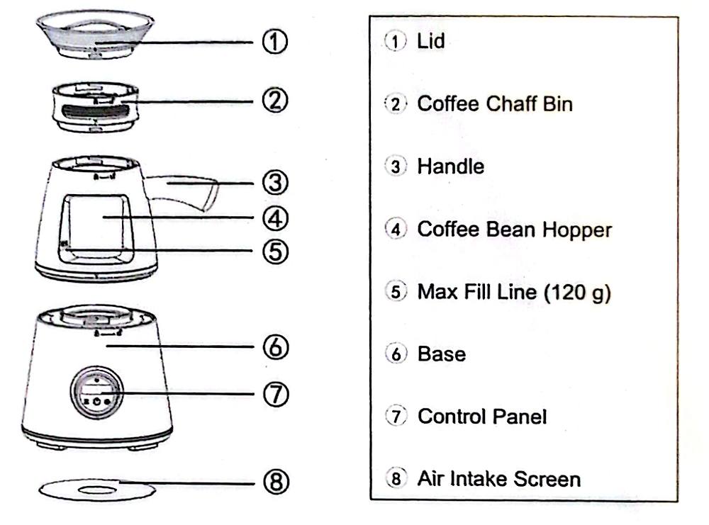
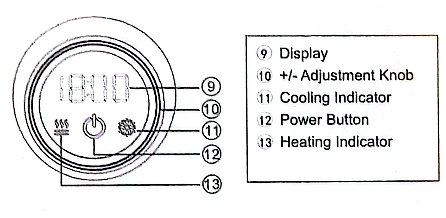
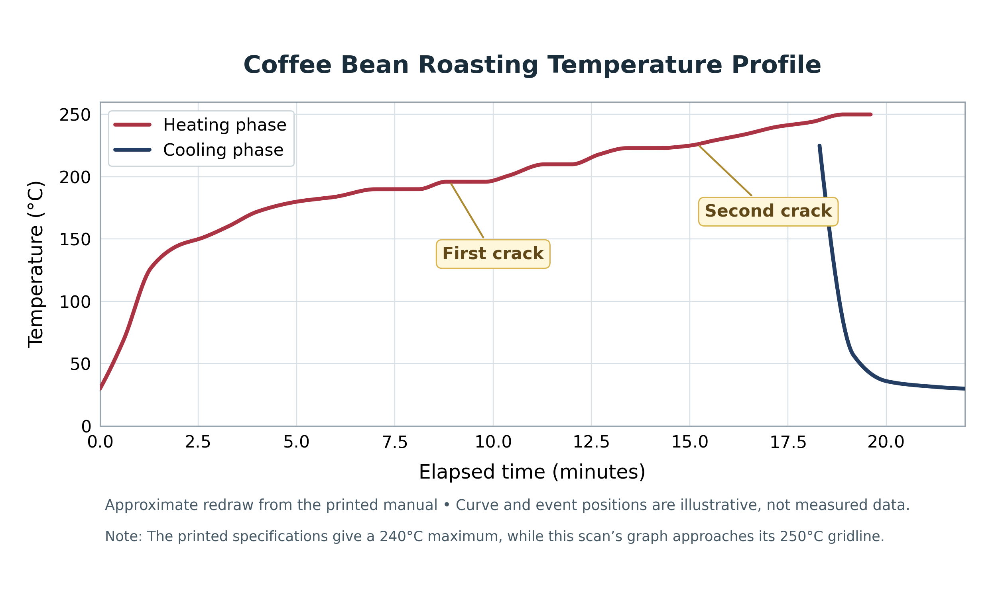

# CBR-120POT coffee roaster — quick reference

This quick reference is extracted from the uploaded **14-page scanned user manual** for model **CBR-120POT**. The scan's cover says "Home Coffee Bean Roaster"; "Luma" is from the uploaded filename. The [full transcribed manual](cbr-120pot-user-manual.md) has detailed instructions, source-page references, and diagrams.

## Operating limits and settings

| Item | Manual says |
|---|---|
| Capacity | **120 g maximum**, and **below MAX line** |
| Electrical | **220–240 V AC, 50/60 Hz, 1500 W** (verify the actual machine's rating label) |
| P01 | Peeled / lower-chaff green beans; time setting **2–18 minutes** |
| P02 | Unpeeled / higher-chaff green beans; time setting **2–18 minutes** |
| P03 | Temperature setting **140–240°C**, fixed **10-minute** heating cycle |
| End of roast | Automatic cooling cycle; **wait for standby before removing beans** |
| Stop roast early | Press Power once to **enter cooling**; wait for cooling to finish before resetting/off |

## Basic operating sequence

1. Confirm correct electrical supply and clear air inlet/outlet. Place appliance on flat surface, away from flammables (manual: **30 cm minimum**).
2. Remove the lid/chaff bin; add **no more than 120 g** of beans, keeping below MAX line; reassemble and lock lid/bin/chamber using the padlock marks.
3. Plug in; hold Power for **3 seconds**.
4. Rotate the adjustment knob to P01 / P02 / P03; press Power once to confirm.
5. Turn knob to desired **time** (P01/P02) or **temperature** (P03); press Power once to start.
6. Let heating and the automatic cooling sequence complete. Remove beans only after standby returns.

## Published roast targets (P01/P02)

| Manual's roast label | Time | Maximum temperature |
|---|---|---|
| Light | 6–8 min | 180°C |
| Medium | 9–11 min | 195°C |
| Dark | 12–14 min | 215°C |
| City | 14–16 min | 225°C |
| Italian | 17–18 min | 240°C |

These are the manual's **reference results**, not guaranteed bean temperatures or repeatable final roast levels. The manual's naming/order of "Dark" versus "City" is reproduced unchanged.

## Manual-described two-stage option

- Run **P02 for 10 minutes** to remove moisture/chaff.
- When its cycle is complete, remove accumulated chaff, then reassemble.
- Run **P03 at a chosen temperature** through its 10-minute cycle.

The manual does **not** give a specific P03 temperature for this option. Treat it as an experimental technique rather than a guaranteed superior outcome. Observe all cooling and handling warnings.

## Diagnosing problems

| Symptom | Manual's first steps |
|---|---|
| **E1** | Temperature sensor open circuit: restart; contact service if persistent |
| **E2** | Check bean weight / MAX line and clean intake and exhaust screens |
| **E3** | Heating or temperature sensor problem: contact service |
| Beans not moving | Check overloading and airflow obstruction |
| Will not start | Disconnect power **more than 20 seconds**, reconnect, then retry |

## Cleaning

Unplug, let cool, keep water out of the electrical base. Clean lid/chaff bin/bean hopper and removable intake screen as directed in the full manual. For the base, use only a damp cloth; no direct rinsing or dishwasher.

## Images

## Questions worth exploring later

The manual supports investigating how **batch size**, **green-bean processing**, **P01 versus P02**, **roast time**, **P03 set temperature**, **P02→P03 staging**, and **chaff cleaning/airflow** change the outcome. Actual effectiveness, the temperature sensor's location, and reproducibility require experimentation or outside research; the scan does not establish them.
