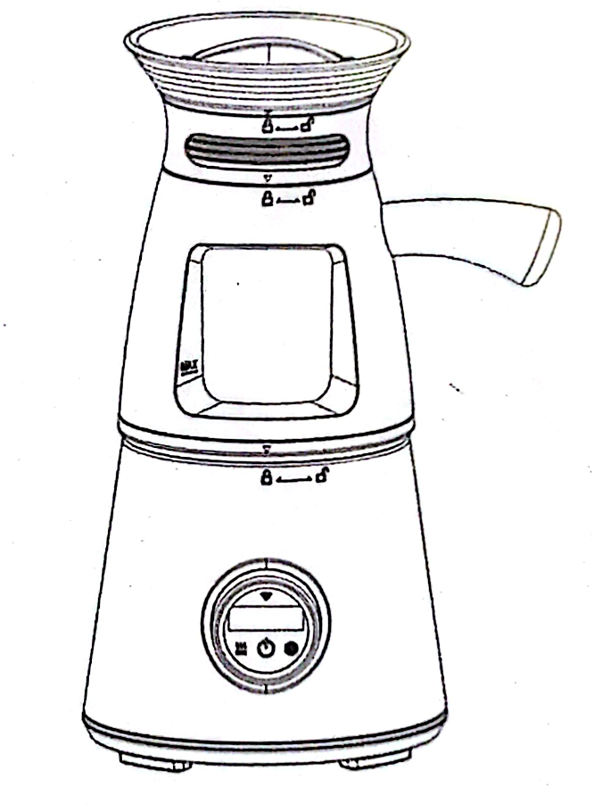
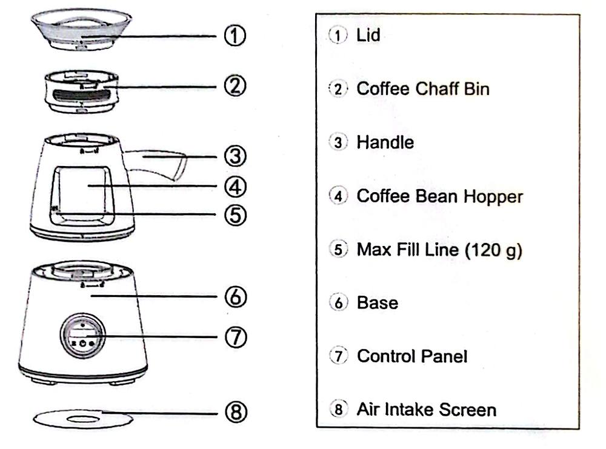
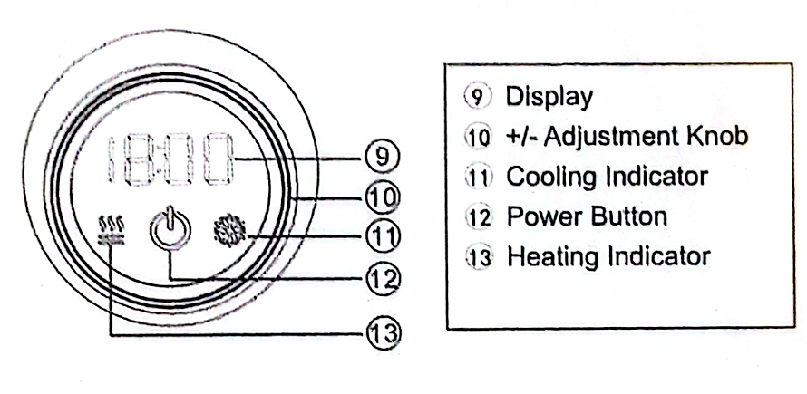
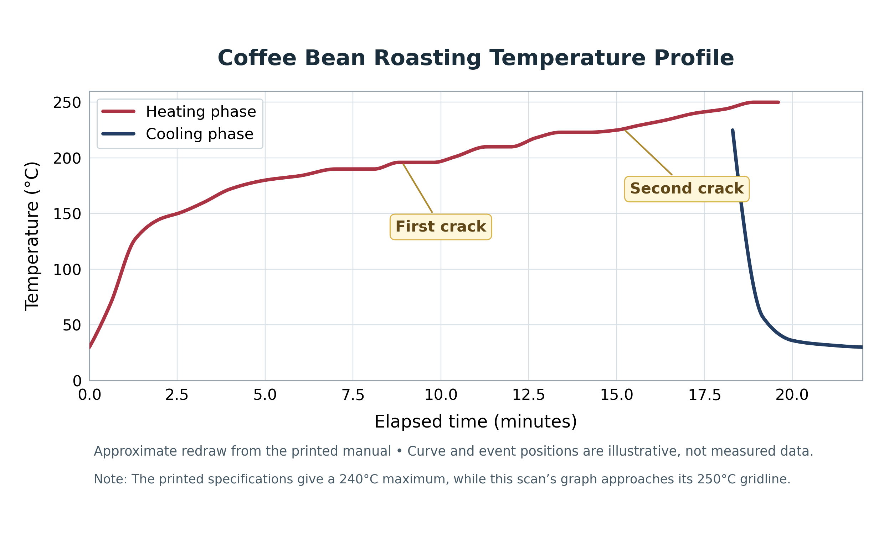

# Home Coffee Bean Roaster — User Manual

**Model: CBR-120POT**  
**Document:** Clean, searchable transcription of *Luma Roaster User Manual.pdf*  
**Source:** 14 scanned PDF pages; the original manual has 12 numbered content pages.  

> **Transcription note:** The text has been reorganized for readability, with spelling, punctuation, capitalization, and line breaks lightly normalized. Technical values, instructions, and the manual's unusual roast classifications are preserved as written. Each section gives its original **printed page number**, and cropped diagrams are reproduced from the source scan. This is a source document, not an independent assessment of roasting best practices.

## Contents

1. [Important safeguards](#1-important-safeguards)
2. [Parts identification](#2-parts-identification)
3. [Operating steps](#3-operating-steps)
4. [Using the control panel and settings](#4-using-the-control-panel-and-settings)
5. [Roasting mode selection](#5-roasting-mode-selection)
6. [Roasting tips and temperature profile](#6-roasting-tips-and-temperature-profile)
7. [Technical specifications](#7-technical-specifications)
8. [Troubleshooting](#8-troubleshooting)
9. [Cleaning and maintenance](#9-cleaning-and-maintenance)
10. [Disposal](#10-disposal)
11. [Source and interpretation notes](#11-source-and-interpretation-notes)

## 1. Important safeguards

*Original printed pp. 1–3; scan pp. 3–5.*

To reduce the risk of fire, electric shock, or injury to persons, always follow basic safety precautions.

### Warning

- Misuse may result in personal injury.
- During operation, or before cooling is complete, the air outlet and surface of the appliance may be hot. Do not touch or approach.
- The appliance must be used under supervision.
- The weight of coffee beans loaded must be **120 g or less** and must not exceed the **MAX fill line**. Otherwise, hot air cannot circulate properly, causing internal overheating and damage.
- Do not cover or block the bottom air inlet or the air outlet while the roaster is in use.
- Do not use near flammable or combustible liquids (for example, gasoline). Place the appliance on a flat table and keep **at least 30 cm** from flammable materials.

### Other precautions for use

- Unplug the power cord before servicing or when not in use.
- Do not use as a toy. Close attention is necessary when used by or near children.
- Use only as described in this manual and only accessories recommended by the manufacturer.
- Do not pull or carry the appliance by its cord, or use the cord as a handle.
- Do not use an extension cord or an outlet with insufficient current capacity.
- Do not use a voltage converter or adapter, or connect the appliance to an outlet with mismatched voltage.
- Do not unplug by pulling on the cord; grasp the plug instead.
- Do not handle the plug or appliance with wet hands.
- Do not put objects into the air inlet or outlet. Keep the openings free of dust, lint, hair, and anything that reduces airflow.
- Periodically clean the lid, coffee chaff bin, and air intake screen to remove dust or debris. This helps maintain smooth airflow, service life, and performance stability.
- When not in use, store indoors in a cool, dry place.

### General appliance safety precautions

1. Read all instructions, including this manual.
2. Do not touch hot surfaces.
3. To prevent electric shock, do not immerse the power cord, plug, or electrical parts in water or other liquid.
4. Children aged 8 and above may use the appliance if supervised or instructed on safe use and if they understand the hazards. Cleaning and maintenance should not be performed by children unless older than 8 and supervised. Keep appliance and cord out of reach of children under 8. Persons with reduced physical, sensory, or mental capabilities, or insufficient experience and knowledge, may use it when supervised or instructed on safe use and hazards.
5. Unplug when not in use and before cleaning. Allow the appliance to cool before assembling or disassembling parts.
6. Do not operate an appliance with a damaged cord or plug, or if it malfunctions or is damaged. Contact the retailer's after-sales service.
7. Attachments not recommended by the manufacturer may cause injury.
8. Do not let the cord hang over the edge of a table or counter, or touch hot surfaces.
9. Do not place the appliance on or near a hot gas or electric burner, or in a heated oven.
10. Do not move the appliance while it is operating.
11. Do not unplug the appliance while it is running.
12. Do not use the appliance for anything other than its intended purpose.
13. Do not insert objects or fingers into gaps in the appliance.
14. Household use only; commercial or industrial use is not recommended. The manual also excludes staff kitchens at workplaces, farmhouses, guest rooms at hotels/motels and similar settings, and bed-and-breakfast environments.
15. Keep plastic packaging bags out of the reach of children after unpacking.

## 2. Parts identification

*Original printed p. 4; scan p. 6.*

| No. | Part |
|---:|---|
| 1 | Lid |
| 2 | Coffee Chaff Bin |
| 3 | Handle |
| 4 | Coffee Bean Hopper |
| 5 | Max Fill Line (120 g) |
| 6 | Base |
| 7 | Control Panel |
| 8 | Air Intake Screen |

**Terminology note:** The operating instructions call the bean-holding section the **Roasting Chamber**; the parts diagram calls part 4 the **Coffee Bean Hopper**.

## 3. Operating steps

*Original printed pp. 4–5; scan pp. 6–7.*

### 3.1 Load the coffee beans

1. Remove the **lid** from the **coffee chaff bin** and remove the coffee chaff bin from the **roasting chamber**. Turn counterclockwise until the triangle mark aligns with the unlocked-padlock symbol, then lift off.
2. Pour coffee beans into the roasting chamber. Use **no more than 120 g** and **do not exceed the MAX fill line**.
3. Correctly attach the coffee chaff bin onto the roasting chamber; place the lid on the chaff bin; then connect the roasting chamber to the main unit. Turn clockwise until the triangle mark aligns with the locked-padlock symbol. This indicates proper installation.

### 3.2 Start operation

1. Connect the power plug to a **properly matched outlet**.
2. Press and hold the **Power Button** on the control panel for **3 seconds** to turn on the appliance.

## 4. Using the control panel and settings

*Original printed pp. 5–6; scan pp. 7–8.*

| No. | Control or indicator | Purpose |
|---:|---|---|
| 9 | Display | Shows selected mode and heating countdown |
| 10 | +/− Adjustment Knob | Rotates to select mode or adjust time/temperature |
| 11 | Cooling Indicator | Lit during cooling mode |
| 12 | Power Button | Power on, confirm, start, or initiate cooling (depending on stage) |
| 13 | Heating Indicator | Lit during heating mode |

### Power on

Press and hold Power Button **12** for **3 seconds**. The display **9** shows roasting mode **P01**.

### Select a roasting mode and start

1. Rotate the +/− Adjustment Knob **10** to select **P01**, **P02**, or **P03**.
2. Press the Power Button **12** once to confirm the selected mode and continue.
3. Rotate the knob to select the desired **target time or temperature** (depending on mode).
4. Press the Power Button **12** once to start.
5. During heating, the Heating Indicator **13** lights and the Display **9** counts down.
6. At countdown zero, the appliance **automatically enters cooling mode**; the Cooling Indicator **11** lights.
7. **Wait until cooling is complete and the appliance returns to standby before removing the beans.**

### Switch manually to cooling mode

During heating, the roasting time cannot be reset and the appliance cannot be forced to turn off. To stop the heating cycle early, **press the Power Button once**. This switches to cooling mode. After the cooling cycle is complete, resetting or turning off becomes possible.

## 5. Roasting mode selection

*Original printed pp. 7–8; scan pp. 9–10.*

| Mode | Bean types or use cases described in manual | Adjustable setting |
|---|---|---|
| **P01** | Peeled green coffee beans, or beans with less chaff residue; examples include washed-process green beans, sun-dried specialty green beans, and polished/peeled beans. | **Time: 2–18 minutes**. Uses the built-in time–temperature profile. |
| **P02** | Unpeeled green coffee beans, or beans with more chaff residue; examples include ordinary sun-dried green coffee and honey-processed green coffee. | **Time: 2–18 minutes**. Uses the built-in time–temperature profile. |
| **P03** | (1) Manual-described "DIY professional roasting" of peeled green coffee beans; (2) re-roasting or drying roasted coffee beans. | **Temperature: 140–240°C; fixed roasting time: 10 minutes**. |

The manual warns that the roaster cannot identify bean types itself; the user must select the appropriate mode.

### P02 + P03 combination (manual's advanced suggestion)

If unsure about mode choice, or if results are unsatisfactory, the manual suggests a two-stage **P02 + P03** sequence:

1. Set **P02 to 10 minutes** to dehydrate the beans and remove chaff.
2. After that cycle is complete, remove the lid and chaff bin, clean out chaff and residue, then reassemble.
3. Select **P03**, set the desired roasting temperature, and allow the P03 cycle to complete.

**Caution:** This sequence is reproduced from the manual; it is not an independently validated coffee-roasting technique. Do not bypass the appliance's cooling or handling precautions. The scanned manual does not quantify a specific P03 temperature for this combination.

## 6. Roasting tips and temperature profile

*Original printed pp. 8–9; scan pp. 10–11.*

### Built-in time–temperature reference profile

The manual says the roaster has a built-in temperature curve. When a roasting time is selected in **P01/P02**, it follows a corresponding temperature profile.

*Figure: Clean redraw of the “Coffee Bean Roasting Temperature Profile” (original printed p. 8). The heating/cooling curves and locations of first and second crack were traced approximately from the scanned figure; this is **not a digitized temperature dataset** or a verified heating program. The original, higher-resolution scan is retained as [the source chart](assets/temperature-profile-original-highres.png). The graph appears to approach the 250°C gridline, while the specifications list a 240°C maximum; this discrepancy is preserved rather than reconciled.*

### Time vs. roast degree — P01/P02 only

| Roast degree (manual's label) | Time setting | Listed maximum temperature |
|---|---|---|
| Light Roast | 6–8 minutes | 180°C |
| Medium Roast | 9–11 minutes | 195°C |
| Dark Roast | 12–14 minutes | 215°C |
| City Roast | 14–16 minutes | 225°C |
| Italian Roast | 17–18 minutes | 240°C |

The manual explains that these values are **for reference only**, based on the roaster's tests, and that bean variety, size, shape, and moisture can change the result. Users can adjust settings from their experience.

**Do not silently reinterpret labels:** The original source lists "Dark Roast" before "City Roast," although that naming/order may differ from other coffee-roasting terminology. The table deliberately retains the source's categories.

## 7. Technical specifications

*Original printed p. 9; scan p. 11.*

| Specification | Manual value |
|---|---|
| Product name | Coffee Bean Roaster |
| Model | CBR-120POT |
| Input voltage | **AC 220–240 V, 50/60 Hz** |
| Rated power | **1,500 W** |
| Capacity | **120 g** |
| Set time range | **2–18 minutes** (P01/P02) |
| Maximum temperature | **240°C** |

**Important verification:** The scanned manual specifies **220–240 V**, not US-standard 120 V. Confirm the electrical rating on the *actual appliance nameplate* matches your supply before using it. The manual itself prohibits mismatched voltage and voltage converters/adapters.

## 8. Troubleshooting

*Original printed p. 10; scan p. 12.*

| Symptom or error | Possible cause (manual) | Manual's recommended action |
|---|---|---|
| **E1** | Temperature sensor open circuit | Turn the appliance off and restart. If it persists, contact after-sales service. |
| **E2** | Too many coffee beans loaded | Check weight/volume; keep bean mass at **120 g or less** and below MAX fill line. |
| **E2** | Airflow obstructed — air intake or exhaust screen clogged | Clean air intake screen and exhaust screen per cleaning instructions. |
| **E3** | No heating | Contact after-sales service. |
| **E3** | Temperature sensor failure | Contact after-sales service. |
| Beans are not being agitated by hot air | Too many beans | Reduce load to **120 g or less** and below fill line. |
| Beans are not being agitated by hot air | Obstructed air intake or exhaust screen | Clean air intake and exhaust screens. |
| Unit does not power on or start | Not specified | Disconnect power for **more than 20 seconds**, then reconnect and retry. If it persists, contact after-sales service. |

## 9. Cleaning and maintenance

*Original printed pp. 11–12; scan pp. 13–14.*

### Cleaning warnings

- Disconnect power **before cleaning** and when unused for an extended period.
- Allow the appliance to **cool completely** before cleaning.
- Never immerse the **base or power-cord plug** in water.
- The manual warns against using detergents, metal brushes, bleach, or similar cleaning substances, while separately allowing mild soapy water / neutral detergent on the **exterior base** when particularly dirty. Follow the part-specific directions below rather than assuming all parts have the same cleaning requirements.

### Part-specific cleaning methods

| Part | Instructions |
|---|---|
| **Base** | Wipe the outside with a damp microfiber cloth. If especially dirty, use mild soapy water or neutral detergent on the cloth. **Never let water enter the power socket**, do not place in dishwasher, and do not rinse directly with water. |
| **Lid** | Brush off dust, chaff, and debris; wipe with damp microfiber cloth; rinse directly with water. The table also indicates dishwasher cleaning is allowed for the grouped removable upper parts. |
| **Coffee Chaff Bin** | Brush off dust, chaff, and debris; wipe with damp microfiber cloth; rinse with water; may be cleaned in dishwasher. |
| **Coffee Bean Hopper** | Brush off dust, chaff, and debris; wipe with damp microfiber cloth; rinse with water; may be cleaned in dishwasher. |
| **Air Intake Screen** | Remove the screen from the base first; brush off debris, wipe with damp microfiber cloth, or rinse directly with water; may be cleaned in dishwasher. |

**Water inside main unit:** The manual says that water entering the electrical interior presents a hazard. Do not power on, operate, or shake the unit if this happens. The original text says to place it flat in a cool, dry location and leave it to dry fully for **5–7 days**, or arrange professional disassembly/drying before use. This is a transcription of the manufacturer's advice, **not a guarantee that an electrically wetted appliance becomes safe after 5–7 days**; professional inspection is the safer path.

## 10. Disposal

*Original printed p. 12; scan p. 14.*

The appliance should **not be disposed of with ordinary household waste**. The manual directs users to responsible recycling through a return or collection system, or to contact the retailer to arrange environmentally safe recycling.

## 11. Source and interpretation notes

- **Model identification:** The scan's cover and technical specifications both identify the machine as **CBR-120POT**. The brand name **"Luma" does not appear in the scanned manual text**; it comes from the uploaded filename.
- **Page mapping:** Scanned PDF pages 1–2 are the cover and contents. Original printed pages 1–12 are scanned PDF pages **3–14** respectively.
- **Transcription scope:** Technical specifications, operating instructions, mode definitions, recommendations, error codes, safety warnings, maintenance, and disposal are preserved. Some redundant, generic safety wording has been lightly shortened, particularly the long child-supervision provision.
- **Chart uncertainty:** The graph image is retained rather than inventing datapoints from an indistinct scan. Its axes show time (minutes) and temperature (°C), with a heating curve and subsequent cooling curve.
- **Internal terminology:** The source alternates "roasting chamber" and "coffee bean hopper" for the upper bean vessel. The mode names and roast degrees are transcribed without correcting their possible technical inconsistencies.
- **Electrical specifications:** Validate against the physical unit's rating label. This transcription alone cannot establish that an individual machine is suitable for your outlet.
- **Usage guidance:** Future roasting suggestions should be explicitly labeled as *experimentation or external guidance* and differentiated from the manual's actual claims.
