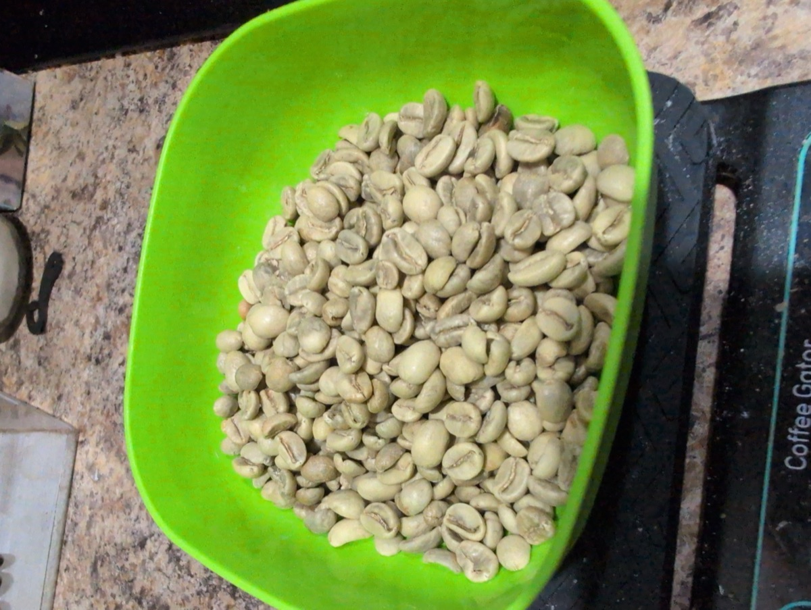

# Roast 2026-11-19-02: Colombia Huila Santa Maria

## Plan rationale

Baseline is roast [2026-11-19-01](2026-11-19-01-colombia-huila-santa-maria-washed-2026a.md) (`P01`, `18 min`, `107.9 g` → `92.8 g`, `14.0 %` loss, `city`, mottled). The one changed variable is the program: `P01 → P02`.

- **Why P02.** P01 is already at its longest setting, 18 min (**manual**), and still ends at `city` on this bean (**observed**, 2026-11-19-01). P02 has the same 2–18 min range (**manual**). The manual recommends P02 for beans with more chaff, such as naturals and honey coffees, and P01 for washed beans, but it gives no safety reason against P02 for washed coffee and does not say how the two programs differ inside the machine.
- **Which way it could go.** If P02 adds heat to dry wetter, chaff-heavy beans, this roast comes out darker. If P02 mostly runs the fan harder to clear chaff, the extra air could cool the beans and the roast comes out lighter (**external guidance**). Either result answers H4.
- **Everything else stays the same.** 108 g, 18 min, cold start, same stop rule.
- **Tasting.** Roasting this within a day or two lets it be tasted side by side with 2026-11-19-01 at Colin's daily recipe (Cosori Juni, `30 g`, Opus 2 `3.5`).

**Confidence: 50 %** that P02 roasts darker than P01. The main uncertainty is what P02 changes inside the machine.

**If darker:** P02 becomes the program for this bean, and the next step is tuning the stop point. **If the same or lighter:** go back to P01 and test P03 next (H5).

## What to note

- Roasted weight (the main number).
- Whether the timer ran out at 18:00 or you pressed Power, and when.
- Any cracking you hear, and when.
- Whether the beans churned freely in the first two minutes.
- Chaff amount compared with roast 2026-11-19-01. A different amount would hint that P02 runs the fan differently.
- A photo of the cooled beans beside 2026-11-19-01.

## During the roast (notes)

Colin's report, 2026-11-19: `108.0 g` in, `94.6 g` out, one photo ([photo](assets/2026-11-19-02-roasted.jpg)), and "What happened here?"

- **Result.** The beans dried but did not roast. They are pale straw to off-white, paler than the green coffee, with no browning anywhere. `12.4 %` weight loss is about the water content of fresh green coffee (around 10–12 %, **external guidance**), so the cycle drove out the water and little else.
- **What it says about P02.** P02 runs far cooler than P01 on this unit. The same bean, load and time on P01 lost `14.0 %` and reached `city` (**observed**, 2026-11-19-01). This fits the manual, which uses a 10-minute P02 cycle to "dehydrate the beans and remove chaff" before a P03 roast (**manual**). P02 seems to be a drying program with more airflow and less heat, not a stronger roast program. One roast, so this is **observed** once, not yet repeated.
- **Beans blown into the chaff catcher.** Colin added that many beans ended up in the chaff catcher. That means P02 blows much harder than P01, which did not do this at the same load (**observed**, 2026-11-19-01). More air through the same heater gives cooler air, and beans sitting in the catcher are out of the hot airflow, which explains the drying-only result. The manual's description fits: P02 is for beans with a lot of chaff, which needs a strong airflow to clear.
- **Not a fault, probably.** Losing 13.4 g of water takes real heat, so the heater did run. Still worth confirming there was no error code and that the timer ran to 18:00.
- **The batch is not wasted.** It is now in the state the manual's P02 + P03 method expects after its first stage. Finishing it with P03 also answers H5.

## Tasting

## Next time

Finish these 94.6 g with P03 as a second stage. Do not use P02 alone to roast on this machine.
