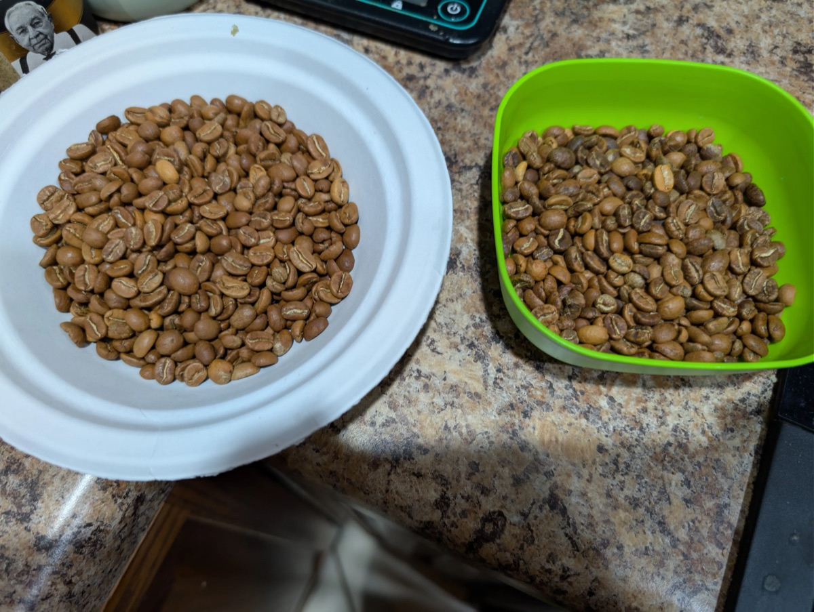

# Roast 2026-11-19-03: Colombia Huila Santa Maria

## Plan rationale

Baseline is roast [2026-11-19-01](2026-11-19-01-colombia-huila-santa-maria-washed-2026a.md) (`P01`, `18 min`, `107.9 g` → `92.8 g`, `14.0 %` loss, `city`, mottled), the best result so far on this bean. This roast finishes the beans from [2026-11-19-02](2026-11-19-02-colombia-huila-santa-maria-washed-2026a.md), where P02 only dried them (`108.0 g` → `101.4 g`, `6.1 %` loss, no browning).

- **Why P03.** P01 is at its 18 min maximum and ends at `city` (**observed**, 2026-11-19-01). P02 runs a strong fan and only dries (**observed**, 2026-11-19-02). P03 is the only program left, and the manual's own method for unsatisfactory results is P02 for 10 min, then P03 (**manual**). These beans have already had their P02 stage.
- **Why 230 °C.** P03 ranges from 140 to 240 °C and always heats for 10 min (**manual**). The manual's chart puts second crack near 225 °C and dark roasts near 235–240 °C (**manual**, chart temperatures, probably air rather than bean temperature). The beans still hold roughly half their water, so P03 has some drying left to do before browning starts. 230 °C leaves room to reach second crack in 10 min, and Power stops it early if it gets there sooner. How P03 heats is untested (H5), so this setting is an estimate.
- **Expected weight.** Ending at `full_city` to `full_city_plus` usually means about 15–17 % total loss for fresh coffee (**external guidance**). From 108.0 g green that is about `89.6–91.8 g`, or `9.5–11.6 %` lost in this stage.
- **Expected events.** Color change about `03:00–04:30`, first crack about `06:00–08:00`. These are guesses from the manual's chart shape and the beans being partly dried, not measurements on this machine.
- **Known downside.** Beans that are cooled partway and reheated can taste flatter than a roast run in one go (**external guidance**). Treat this cup as a test of the method, not the best this bean can do.

**Confidence: 45 %** that this ends at `full_city` or darker, at 89–92 g. The main uncertainty is P03 itself: its fan strength and how fast it reaches 230 °C are both unknown (H5).

**Knob values.** This unit shows P03 temperatures in °F (**observed**, 2026-11-19: the knob stops at 284, which is 140 °C). Set **446 °F** for 230 °C.

**If it ends before first crack:** P03 at 230 °C is too gentle for a 10-minute stage. Next time, try 240 °C (464 °F). **If second crack comes before about 07:00:** next time, try 220 °C (428 °F).

## Before the roast

1. Empty the chaff bin and clean the intake screen (**manual**, P02 + P03 method).
2. Put all 101.4 g back in: the chamber beans and the 6.8 g from the chaff catcher together. Check they sit below the MAX fill line (**manual**).
3. Count-up stopwatch ready.

## During the roast

1. Hold Power `3 s`, knob to `P03`, press Power, knob to **`446`** (°F, which is 230 °C; this unit shows °F), press Power, start the stopwatch. Stay with the roaster the whole cycle (**manual**).
2. In the first minute, check the whole bed churns and note whether beans are being blown into the chaff catcher, as they were on P02.
3. Note color change, any cracking, smoke, and second-crack snaps.
4. Follow the stop rule. Unload only after cooling ends and the unit returns to standby (**manual**).

## After the roast

1. Weigh all the beans, including any in the chaff catcher.
2. Note the chaff amount and photograph the beans beside 2026-11-19-01.
3. Store airtight and rest at least 4 days. Taste beside 2026-11-19-01 with the daily recipe (Cosori Juni, `30 g`, Opus 2 `3.5`).

## During the roast (notes)

Colin's report, 2026-11-19: `94.4 g` out, with a photo of this roast (left) beside 2026-11-19-01 (right) ([photo](assets/2026-11-19-03-vs-01.jpg)).

- **Weight.** `101.4 → 94.4 g` is `6.9 %` in this stage. From the original `108.0 g` green the total is `12.6 %`, below P01's `14.0 %` (**observed**, 2026-11-19-01) and short of the planned `15–17 %`.
- **Color.** An even, light caramel brown with no dark mottling, and lighter on average than the P01 roast. Judged `light`. Much more even than 2026-11-19-01, which has dark patches beside pale beans. No oil, no sign of second crack.
- **Setting used.** Colin believes he set **464 °F (240 °C)**, the maximum, not the planned 446 °F (230 °C).
- **What it says about P03.** Even at its maximum, 240 °C for 10 minutes on partly dried beans roasted gently and evenly, but not far enough. It did not reach the planned `full_city`. Whether it reached first crack is not known.
- **Evenness.** Drying first (P02) and then roasting (P03) gave a far more even color than P01 alone. Drying the beans evenly before browning starts is a common way to reduce mottling (**external guidance**).

## Tasting

## Next time

P03 was already at its maximum, 240 °C (464 °F), and the roast was still light. More roast has to come from the first stage: P01 for 18 min reaches `city` on its own (2026-11-19-01), so try P01 18 min and then P03 at 240 °C.
