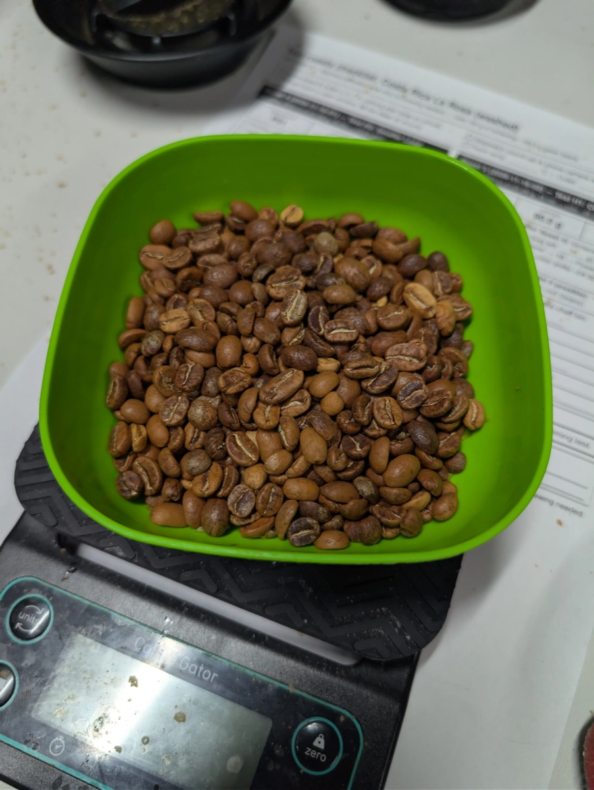

# Roast 2026-11-19-04: Colombia Huila Santa Maria

## Plan rationale

Baseline is roast [2026-11-19-01](2026-11-19-01-colombia-huila-santa-maria-washed-2026a.md) (`P01`, `18 min`, `107.9 g` → `92.8 g`, `14.0 %` loss, `city`, mottled). The change is a second stage after it: P03 at its maximum, 240 °C (464 °F). Colin chose this over first repeating [2026-11-19-03](2026-11-19-03-colombia-huila-santa-maria-washed-2026a.md) with a confirmed 464 °F knob.

- **Why P01 first.** P01 18 min takes this bean to `city` on its own (**observed**, 2026-11-19-01). P02 18 min only dried it and lifted beans into the chaff catcher (**observed**, 2026-11-19-02). Starting from `city` leaves P03 only the last part of the roast to do.
- **Why P03 at 240 °C (464 °F).** It is the maximum (**manual**). After a P02 stage, P03 at 230 or 240 °C (the setting is not certain) added `6.9 %` loss and ended `light` (**observed**, 2026-11-19-03). Starting from `city` instead, the same heat should carry the beans into second crack.
- **Two-stage method.** The manual's version is P02 then P03 (**manual**). Using P01 as the first stage is not in the manual, but it uses the same programs within their limits. Beans cooled between stages and reheated can taste flatter than a single roast (**external guidance**).
- **Expected weight.** `full_city_plus` is usually about 16–18 % total loss on fresh coffee (**external guidance**): about `88.6–90.7 g` from 108.0 g. Below about 88 g, or any oil on the beans, means it went past the target.
- **Expected events (stage 2).** The beans start the stage cool, at `city`. Second crack, if it comes, probably in the second half of the 10 minutes. This is a guess.
- **Evenness.** P01 alone gave a mottled roast (**observed**, 2026-11-19-01). The P03 stage may even it out, or the mottling may stay.

**Confidence: 50 %** that this ends at `full_city` to `full_city_plus`, 88–91 g. The main risks are overshooting into `vienna` if second crack comes fast, and finding that P03 still adds too little heat.

## Stage 1: P01

1. Cold roaster, chaff bin empty. Range hood on or window open, 30 cm clear all round (**manual**).
2. Weigh `108.0 g`. Check below the MAX fill line (**manual**).
3. Hold Power `3 s`, knob to `P01`, press Power, knob to `18`, press Power, start the stopwatch.
4. Let it run the full 18:00 and the automatic cooling. Note color change.

## Between stages

1. Once it is back in standby, empty the chaff bin (**manual**, two-stage method).
2. Optional: weigh all the beans, including any in the chaff catcher. This gives a check against roast 1's `92.8 g`.
3. Put all the beans back. Move on soon, without a long wait.

## Stage 2: P03

1. Hold Power `3 s`, knob to `P03`, press Power, knob to **`464`** (°F, 240 °C). **Check it reads 464, take a photo**, press Power, restart the stopwatch from zero.
2. Watch the first minute for beans blowing into the chaff catcher.
3. Listen for cracking. Second crack is a quieter, faster crackle like rice cereal in milk, often with a jump in smoke.
4. Follow the stop rule. Unload only after cooling ends and the unit returns to standby (**manual**).

## After the roast

1. Weigh all the beans, including any in the chaff catcher.
2. Photograph them beside roasts 2026-11-19-01 and 2026-11-19-03.
3. Store airtight and rest at least 4 days.

## During the roast (notes)

Colin's mid-roast report, 2026-11-19:

- **After stage 1 (P01, 18 min):** `108.0 g` → `96.0 g`, `11.1 %` loss ([photo](assets/2026-11-19-04-after-p01.jpg)). Light to light-medium and mottled, like roast 2026-11-19-01, but that roast lost `14.0 %` (`92.8 g`) at the same settings. Colin confirmed a cold start (at least 30 min after the previous roast), P01 for the full 18 min, and about the same garage temperature as roast 1. He then found the likely reason: in roast 1 he discarded the less-roasted beans from the chaff catcher before weighing, and here he put them back. So roast 1's `14.0 %` was overstated, and the two P01 stages probably roasted about the same.
- **Spill between stages:** `3.5 g` fell on the floor, so stage 2 (P03) started with `92.5 g`. Total loss from green can only be estimated: scale the final weight by `96.0 / 92.5`. Target for `full_city_plus` (16–18 % total) is now about `85–87.5 g` at the end.

## Tasting

## Next time
